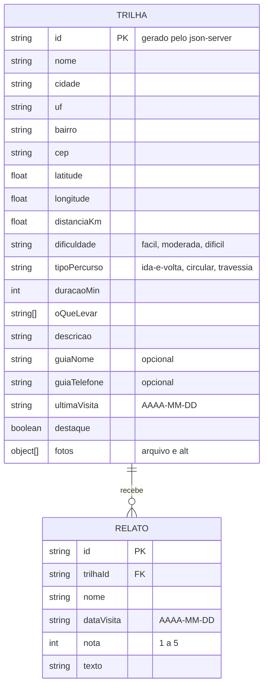

# 🛠️ Arquitetura do Trilheiro

Primeira versão: só o modelo de dados, tirado das histórias do [PRD](prd.md). As outras seções (design tokens, rotas, APIs) chegam nos próximos capítulos.

## Modelo de dados (diagrama ER)

