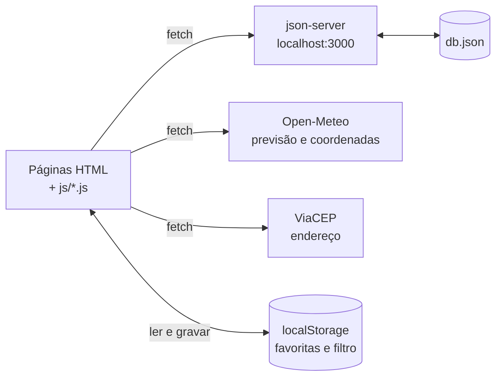
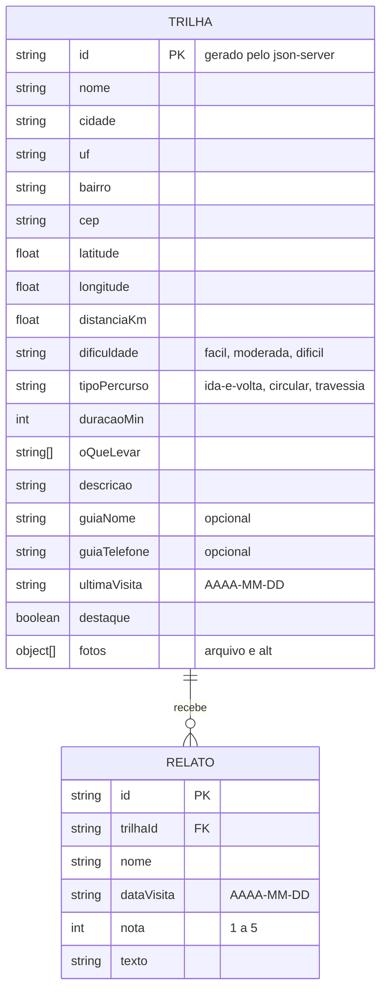

# 🛠️ Arquitetura do Trilheiro

Este documento descreve como o Trilheiro é construído: as tecnologias, as páginas, o modelo de dados, as rotas do json-server, as APIs públicas e o que fica guardado no navegador. As regras de negócio (RN01 a RN07) estão no [PRD](prd.md). As cores, as fontes e os componentes estão no [Design System](design-system.md).

## 1. Visão geral

| Camada | Tecnologia | Para quê |
|---|---|---|
| Estrutura | HTML5 semântico | As 4 páginas |
| Estilo | **Bootstrap 5.3**, personalizado com **Sass** | Grid, componentes e o tema da trilha |
| Comportamento | **JavaScript** (módulos ES), **jQuery 4** e o **jQuery Mask Plugin** | Filtro, favoritas, formulários, chamadas às APIs |
| Dados do app | **json-server** | Trilhas e relatos (API REST local, a partir do `db.json`) |
| Dados de fora | **Open-Meteo** e **ViaCEP** | Previsão do tempo, coordenadas da cidade, endereço pelo CEP |
| Navegador | **Web Storage** (`localStorage`) | Favoritas e último filtro |
| Publicação | **GitHub Pages** | Site estático |

Não há build de JavaScript. O Sass é compilado para `css/main.css`, que vai para o repositório. O JavaScript do Bootstrap, o jQuery e o plugin de máscara vêm de um **CDN**, para funcionarem igual no computador e no site publicado.



## 2. Páginas e arquivos

| Página | Arquivo | Script |
|---|---|---|
| Início | `index.html` | `js/home.js` |
| Trilhas | `trilhas.html` | `js/trails.js` |
| Detalhe da trilha | `trilha.html?id=ID` | `js/trail-detail.js` |
| Cadastrar trilha | `cadastrar.html` | `js/trail-form.js` |

```
trilheiro/
├── index.html  trilhas.html  trilha.html  cadastrar.html
├── db.json
├── package.json            scripts "sass", "api", "format" e "lint"
├── eslint.config.mjs  .prettierrc.json  .prettierignore
├── .vscode/                o Live Server ignora o db.json; formatar ao salvar
├── scss/
│   ├── main.scss           tema → Bootstrap → parciais próprios
│   ├── _tokens.scss        os tokens do design system, como variáveis Sass
│   ├── _theme.scss         variáveis do Bootstrap (antes dele)
│   ├── _functions.scss  _mixins.scss
│   └── _layout.scss  _acessibilidade.scss  _navbar.scss  _hero.scss  _cards.scss  _trilha.scss  _form.scss  _footer.scss
├── css/main.css            compilado pelo Sass, comprimido (vai para o repositório)
├── js/
│   ├── api.js              json-server e modo publicado (seção 6)
│   ├── weather.js          Open-Meteo
│   ├── address.js          ViaCEP e coordenadas da cidade
│   ├── storage.js          favoritas e filtro (seção 9)
│   ├── favorites.js        a lista de favoritas
│   ├── trail.js            a classe Trail (os dados e a formatação)
│   ├── format.js           duração, distância e datas
│   ├── trail-card.js       monta o cartão de uma trilha
│   ├── feedback.js         avisos de "carregando" e de erro
│   └── home.js  trails.js  trail-detail.js  trail-form.js
└── img/                    fotos em WebP e JPEG, em duas larguras; ícone da aba; foto padrão
```

Os nomes no código (arquivos, funções, classes CSS próprias) são em inglês. Os dados e as rotas são em português, porque são o vocabulário do domínio: `trilhas`, `relatos`, `dificuldade`.

**Exceção:** as classes CSS e as variáveis Sass próprias nasceram em português nos capítulos de Sass do livro (`.secao-titulo`, `.hero__texto`, `$verde-mata`, `$dificuldades`) e continuam assim, para o app final ser igual ao que o livro constrói. Os arquivos, as funções e as classes JavaScript seguem em inglês.

## 3. Modelo de dados (diagrama ER)



## 4. Dicionário de dados

### Trilhas (`trilhas`)

| Campo | Tipo | Obrigatório | Regra |
|---|---|---|---|
| `id` | texto | sim | Gerado pelo json-server no `POST` |
| `nome` | texto | sim | De 3 a 80 caracteres (RN01) |
| `cidade`, `uf`, `bairro` | texto | sim (`bairro` não) | Preenchidos pelo ViaCEP e editáveis |
| `cep` | texto | sim | Gravado no formato `00000-000` (RN04) |
| `latitude`, `longitude` | número | não | Do centro da cidade, pela Open-Meteo, ao cadastrar (seção 7.2). Sem elas, o detalhe avisa que não há previsão |
| `distanciaKm` | número | sim | De 0,5 a 50, com uma casa decimal (RN02) |
| `dificuldade` | texto | sim | `facil`, `moderada` ou `dificil` (RN03) |
| `tipoPercurso` | texto | sim | `ida-e-volta`, `circular` ou `travessia` (RN03) |
| `duracaoMin` | número | sim | Duração estimada, em minutos (de 10 a 1440) |
| `oQueLevar` | lista de textos | não | Valores de `agua`, `lanche`, `protetor-solar`, `repelente`, `capa-de-chuva`, `lanterna` |
| `descricao` | texto | sim | De 20 a 1000 caracteres |
| `guiaNome`, `guiaTelefone` | texto | não | Telefone no formato `(00) 00000-0000` (RN04) |
| `ultimaVisita` | texto | sim | Data `AAAA-MM-DD`, nunca no futuro (RN05) |
| `destaque` | booleano | sim | `true` aparece no Início (até 3). Uma trilha cadastrada entra com `false` |
| `fotos` | lista de `{ arquivo, alt }` | não | `arquivo` é o nome sem tamanho nem extensão (seção 8). Lista vazia mostra a foto padrão |

### Relatos (`relatos`)

| Campo | Tipo | Obrigatório | Regra |
|---|---|---|---|
| `id` | texto | sim | Gerado pelo json-server |
| `trilhaId` | texto | sim | O `id` da trilha (o nome segue o padrão do json-server, `<coleção no singular>Id`) |
| `nome` | texto | sim | De 2 a 60 caracteres |
| `dataVisita` | texto | sim | `AAAA-MM-DD`, nunca no futuro (RN05) |
| `nota` | número | sim | Inteiro de 1 a 5 |
| `texto` | texto | sim | De 10 a 500 caracteres |

## 5. Rotas do json-server

Conferidas com o **json-server 1.0.0-beta.15** (`npx json-server db.json`, porta 3000).

| Rota | Usada em | Para quê |
|---|---|---|
| `GET /trilhas` | Início, Trilhas | Todas as trilhas. O Início fica com as de `destaque: true`; a tela Trilhas filtra por dificuldade e favoritas no JavaScript |
| `GET /trilhas/:id?_embed=relatos` | Detalhe | A trilha com os relatos dela dentro, num campo `relatos`. Id inexistente responde **404** |
| `POST /trilhas` | Cadastrar | Grava uma trilha e responde com ela, já com o `id` gerado |
| `POST /relatos` | Detalhe (modal) | Grava um relato, com o `trilhaId` |

**Por que filtrar no JavaScript, e não na URL?**
- **O filtro vem antes do servidor.** O filtro por dificuldade e as favoritas nascem no capítulo do DOM e dos eventos, quando as trilhas ainda são um array no próprio JavaScript. Quando o json-server chega, só muda a origem do array.
- **O modo publicado não tem servidor** (seção 6), e o mesmo código precisa funcionar nos dois.
- **A armadilha dos ids numéricos.** Na versão 1.0.0-beta.15, `GET /relatos?trilhaId=1` volta **vazio**, mesmo havendo relatos com `"trilhaId": "1"`. O json-server converte o `1` da URL em número, e o número `1` não é igual ao texto `"1"`. O `_embed` não tem esse problema.

## 6. Modo local e modo publicado

O GitHub Pages serve só arquivos: não há json-server no site publicado. Por isso o `js/api.js` tem dois modos, escolhidos pelo endereço:

| | Modo local (`localhost` ou `127.0.0.1`) | Modo publicado (qualquer outro endereço) |
|---|---|---|
| Leitura | `http://localhost:3000/...` | O arquivo `db.json`, lido com `fetch('db.json')`; o `_embed` é feito no JavaScript |
| Cadastro e relato | `POST` no json-server | Desligados, com o aviso "No site publicado, o Trilheiro só mostra as trilhas. Para cadastrar, rode o projeto no seu computador." |

Funções do `api.js`, as únicas que as páginas usam para os dados:

| Função | Retorna |
|---|---|
| `getTrails()` | `Promise<Trail[]>` |
| `getTrail(id)` | `Promise<Trail & { relatos: Report[] }>`. Rejeita com `NotFoundError` se a trilha não existir |
| `createTrail(trail)` | `Promise<Trail>`, com o `id` |
| `createReport(report)` | `Promise<Report>` |
| `canWrite()` | `true` no modo local |

## 7. APIs públicas

As duas são gratuitas, sem chave e aceitam chamadas direto do navegador (CORS liberado).

### 7.1. Open-Meteo: previsão do tempo

```http
GET https://api.open-meteo.com/v1/forecast?latitude=-25.39&longitude=-51.46&daily=temperature_2m_max,temperature_2m_min,precipitation_probability_max&timezone=America%2FSao_Paulo&forecast_days=3
```

Resposta (resumida):

```json
{
  "daily_units": { "temperature_2m_max": "°C", "precipitation_probability_max": "%" },
  "daily": {
    "time": ["2026-11-04", "2026-11-05", "2026-11-06"],
    "temperature_2m_max": [24.7, 25.2, 24.1],
    "temperature_2m_min": [16.8, 16.3, 15.8],
    "precipitation_probability_max": [100, 100, 100]
  }
}
```

- Os dias vêm em listas paralelas: o dia `i` é `time[i]`, `temperature_2m_max[i]`, e assim por diante.
- A resposta devolve a latitude e a longitude do ponto da grade mais próximo, que pode ser um pouco diferente do que foi pedido.
- **Obrigatório citar a fonte:** "Dados: Open-Meteo", com link para `https://open-meteo.com`.
- Falha de rede ou status diferente de 200: a seção mostra "Não foi possível carregar a previsão agora", e o resto da página continua (RN07).

### 7.2. Open-Meteo: coordenadas da cidade (geocodificação)

Usada ao cadastrar uma trilha, para gravar a latitude e a longitude do centro da cidade que o ViaCEP devolveu.

```http
GET https://geocoding-api.open-meteo.com/v1/search?name=Prudent%C3%B3polis&count=5&language=pt&countryCode=BR
```

- A resposta traz uma lista `results`, com `name`, `admin1` (o estado por extenso), `latitude` e `longitude`. Pode haver mais de um lugar com o mesmo nome: use o primeiro cujo `admin1` seja igual ao `estado` do ViaCEP.
- Cidade não encontrada: a resposta **não tem** o campo `results`. A trilha é gravada sem coordenadas.

### 7.3. ViaCEP: endereço pelo CEP

```http
GET https://viacep.com.br/ws/85010260/json/
```

```json
{ "cep": "85010-260", "logradouro": "Rua Vicente Machado", "bairro": "Centro",
  "localidade": "Guarapuava", "uf": "PR", "estado": "Paraná", "ddd": "42" }
```

- Mande só os 8 dígitos, sem o hífen. A consulta só acontece quando o CEP está completo e válido (RN04).
- `localidade` vai para `cidade`; `uf` e `bairro`, para os campos de mesmo nome. CEP geral de cidade pequena vem com o `bairro` vazio.
- **CEP inexistente:** a resposta tem status 200 e o corpo `{ "erro": "true" }`. É preciso olhar o corpo, e não só o status.
- **CEP em formato errado** (por exemplo, 3 dígitos): status **400**.
- Em qualquer falha, a cidade e o bairro continuam editáveis, com a mensagem "CEP não encontrado. Preencha a cidade e o bairro" (RN07).

## 8. Fotos

Cada foto existe em WebP, em duas larguras: `img/trilhas/<arquivo>-480.webp` e `img/trilhas/<arquivo>-960.webp`. O cartão e o carrossel usam `srcset` com as duas e `sizes` conforme a coluna do grid. Trilha sem foto mostra `img/trilha-sem-foto.svg`.

## 9. Web Storage

| Chave | Valor | Exemplo |
|---|---|---|
| `trilheiro:favoritas` | JSON com a lista de ids | `["1","R2PztqBWwyw"]` |
| `trilheiro:filtro` | `todas`, `facil`, `moderada`, `dificil` ou `favoritas` | `moderada` |

Leitura dentro de `try/catch`: valor ausente, JSON inválido ou navegador que bloqueia o armazenamento voltam ao padrão (lista vazia, `todas`), sem quebrar a página.

## 10. Bibliotecas pelo CDN

| Biblioteca | Versão | Endereço |
|---|---|---|
| Bootstrap (JS, com Popper) | 5.3.8 | `https://cdn.jsdelivr.net/npm/bootstrap@5.3.8/dist/js/bootstrap.bundle.min.js` |
| Bootstrap Icons (CSS) | 1.13.2 | `https://cdn.jsdelivr.net/npm/bootstrap-icons@1.13.2/font/bootstrap-icons.min.css` |
| jQuery | 4.0.0 | `https://cdn.jsdelivr.net/npm/jquery@4.0.0/dist/jquery.min.js` |
| jQuery Mask Plugin | 1.14.16 | `https://cdn.jsdelivr.net/npm/jquery-mask-plugin@1.14.16/dist/jquery.mask.min.js` |

O jQuery entra no `trilhas.html` (a animação do filtro) e no `cadastrar.html` (as máscaras). As fontes vêm do Google Fonts com `display=optional`: se não chegarem a tempo do primeiro desenho, a página fica com a fonte do sistema, e o texto não pula de lugar quando elas chegam. O plugin de máscara foi conferido com o jQuery 4.0.0 (`mask('00000-000')` e `mask('(00) 00000-0000')`). O CSS do Bootstrap não vem do CDN: ele é compilado junto com o tema, pelo Sass.

## 11. Estrutura do `db.json`

O arquivo completo, com as trilhas de exemplo, fica em `trilheiro/db.json`. A estrutura:

```json
{
  "trilhas": [
    {
      "id": "1",
      "nome": "Trilha do Salto",
      "cidade": "Prudentópolis",
      "uf": "PR",
      "bairro": "",
      "cep": "84400-000",
      "latitude": -25.21,
      "longitude": -50.98,
      "distanciaKm": 4.5,
      "dificuldade": "moderada",
      "tipoPercurso": "ida-e-volta",
      "duracaoMin": 150,
      "oQueLevar": ["agua", "lanche", "repelente"],
      "descricao": "Descida por mata de araucárias até a base de uma queda-d'água, com volta pelo mesmo caminho.",
      "guiaNome": "",
      "guiaTelefone": "",
      "ultimaVisita": "2026-10-12",
      "destaque": true,
      "fotos": [{ "arquivo": "salto-1", "alt": "Queda-d'água vista de baixo, entre pedras e mata" }]
    }
  ],
  "relatos": [
    {
      "id": "1",
      "trilhaId": "1",
      "nome": "Ana",
      "dataVisita": "2026-10-12",
      "nota": 5,
      "texto": "Descida tranquila, mas a volta cansa. Leve água de sobra."
    }
  ]
}
```
